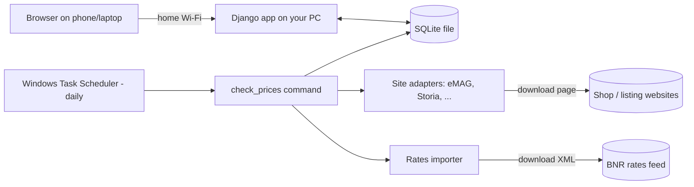

# Project Plan: Price Tracker

*Status: approved on 2026-10-31. Planning only: no code has been written yet.*

Facts are labelled **Verified** (checked on 2026-10-31), **Estimate** or **Assumption**.

---

## 1. Executive summary

A web app that runs on your own computer. You and your family use it from any browser on the home Wi-Fi to track how prices change over time. It covers shop products, rentals and apartments, subscriptions, and manual-only costs like electricity.

- **Automatic tracking:** you paste a link, and the app re-checks the price every day.
- **Manual entry:** for anything without a public price page.
- **Currencies:** RON and EUR, converted at the official rate of the day each price was recorded, and shown in each user's favourite currency.
- **Comparison:** you can put items in a group (say, the same TV at eMAG vs. Altex) and compare them on one chart.

**Recommended approach:** Python with **Django**, a **SQLite** database, **Chart.js** for charts, and one small "adapter" module per website. A daily task started by Windows Task Scheduler re-checks prices.

## 2. Problem and target users

- **Problem:** price trackers usually cover online shopping only. Your rent, apartment prices, subscriptions and bills sit in separate places, with no history and no way to compare.
- **Users:** you plus a few family members or friends, each with their own login. It may go public later.
- **Constraints:**
  - Beginner Python and HTML skills, about 8 hours a week
  - Runs locally at no cost
  - Romania: RON and EUR
  - Sites of interest: emag.ro, altex.ro, olx.ro, storia.ro, imobiliare.ro

## 3. Scope

### MVP (essential)

| # | Feature | Why it matters |
|---|---|---|
| 1 | Accounts and favourite currency | Each person sees only their own items, in their chosen currency. It's also needed before going public. |
| 2 | Items with flexible categories and custom fields | You can add a new category like "Fuel" without changing code |
| 3 | Manual price entry | Works for anything, and is the fallback when automatic reading fails |
| 4 | Automatic tracking from a link (2 sites to start) | The main convenience feature |
| 5 | Daily scheduled re-checks | History builds up without you doing anything |
| 6 | Price history chart | Shows the trend |
| 7 | Conversion at the historical daily rate | Accurate comparisons across RON and EUR |
| 8 | Change indicators ("↓8%", "lowest ever", "listing removed") | Shows "is it getting cheaper?" at a glance |
| 9 | Comparison groups | Comparing alternatives, which is essential from day one |

### Optional (next)

- Target-price alerts by email or browser notification
- Adapters for the remaining 3 sites
- CSV export and import
- Letting users create their own categories (only the admin can in the MVP)
- Price per m² in comparisons

### Future

- Public hosting
- Market averages (e.g. average rent per m² in Cluj)
- Reading prices from PDF bills and receipts
- A phone app and a browser extension
- Price forecasts

## 4. Technology stack

A **framework** is a ready-made toolkit that handles common jobs so you only write what's unique to your app.

### 4.1 Python 3.14: programming language

- **Verified:** Python 3.14.0 is installed on the development PC.
- **Why:** you already know some Python, and it's the strongest language for reading web pages.
- **Cost:** free.
- **Alternative:** JavaScript with Node.js. It's also good, but you'd be learning a new language at the same time.
- **Status:** essential.

### 4.2 Django: web framework

- **What it does:** turns your Python code into a website. It includes the main building blocks:
  - **Login and accounts**
  - **ORM:** you work with the database using Python instead of SQL, the database query language
  - **Migrations:** automatic, versioned changes to the database structure
  - **Forms** with input checking
  - **HTML templates**
  - An **admin panel**: a ready-made back office where you can add categories without writing any pages
- **Why it fits:** accounts, forms and admin are about a third of the MVP, and Django provides them almost for free.
- **Pros:** "batteries included", excellent documentation, very mature, an easy move to a public server later.
- **Cons:** a fair amount of structure to learn at first, and it's less suited to very interactive interfaces.
- **Alternatives:**
  - **Flask:** smaller and simpler at the start, but you'd add login, admin and migrations yourself.
  - **FastAPI + React:** modern, but two projects and two languages. Too much for now.
- **Cost:** free.
- **Lock-in:** high; switching away later means a rewrite. That's acceptable because Django is long-lived and widely used.
- **Assumption:** the current Django release supports Python 3.14. Confirm the exact version at setup, or use Python 3.13 if needed.
- **Status:** essential.

### 4.3 SQLite now, PostgreSQL later: database

- **What it does:** stores all the data. SQLite keeps the whole database in one file, so there's no server to install.
- **Verified:** the local SQLite (3.50.4) supports JSON, which the flexible category fields need.
- **Pros:** zero setup, and backup means copying one file.
- **Cons:** weak when many people write at the same moment. That's fine for a household, but not for a public app.
- **Alternative:** PostgreSQL. It's the right choice when going public. Django makes the move mostly a configuration change plus a data copy.
- **Cost:** free.
- **Status:** essential.

### 4.4 Django templates, plus Bootstrap (optional): user interface

- **What it does:** the server builds the HTML pages. **Bootstrap** is a ready-made style kit that makes pages look decent and work on phones.
- **Why:** you already know HTML, and this avoids a separate frontend project.
- **Alternative:** React, which gives a richer interface but doubles what you have to learn. Not needed here.
- **Cost:** free.
- **Status:** templates are essential; Bootstrap is optional but recommended.

### 4.5 Chart.js: charts

- **What it does:** a small JavaScript library that draws line charts in the browser from your price data.
- **Pros:** simple, good documentation, and handles several lines on one chart, which comparison needs.
- **Alternatives:** Plotly (heavier); Matplotlib (makes static images and isn't interactive).
- **Cost:** free.
- **Status:** essential.

### 4.6 httpx + BeautifulSoup: reading web pages ("scraping")

- **What they do:**
  - **httpx** downloads a page's HTML, the code behind a web page.
  - **BeautifulSoup** lets you search that HTML for the price.
- **Strategy:** many shops embed **structured data**, a hidden machine-readable block with the product's name and price. Reading it is more robust than locating the price on the visible page.
- **Fallback (postponed):** **Playwright**, which drives a real hidden browser. It's for sites that build the page with JavaScript or block simple programs. It's slower and heavier.
- **Cost:** free.
- **Status:** essential (Playwright only if the spike shows it's needed).

### 4.7 National Bank of Romania (BNR) XML feed: exchange rates

- **Verified (2026-10-31):**
  - `https://curs.bnr.ro/nbrfxrates.xml` returns the daily official rates (EUR = 5.3426 RON on 2026-10-30).
  - Full-year history files also work, for example `https://curs.bnr.ro/files/xml/years/nbrfxrates2025.xml`.
  - The old `www.bnr.ro/nbrfxrates.xml` address now just sends you to the homepage, so it no longer gives the rates.
- **Why:** an official, free source with no account, in RON, the currency your sites use. It also covers many other currencies, so adding USD later is easy.
- **Alternative (verified working):** the European Central Bank's daily feed, based on EUR (`https://www.ecb.europa.eu/stats/eurofxref/eurofxref-daily.xml`), gave RON = 5.3447 on the same day.
- **Cost:** free.
- **Status:** essential.

### 4.8 Django "management command" + Windows Task Scheduler: daily checks

- **What it does:** a management command is a script you run as `python manage.py check_prices`. Windows Task Scheduler, which is built into Windows, runs it daily.
- **Pros:** nothing extra to install, and it's easy to understand.
- **Cons:** it only runs while the PC is on; a missed day is simply skipped.
- **Alternatives:**
  - **APScheduler:** a scheduler inside the app itself.
  - **Celery + Redis:** a professional job queue. It's overkill now and maybe useful when public.
- **Status:** essential.

### 4.9 Django's built-in test tools: testing

- **What it does:** **automated tests** are small programs that check your code still works, for example "this saved eMAG page produces 2,499.99 RON".
- **Alternative:** pytest, which is nicer to write but is one more tool to learn.
- **Status:** essential, used from milestone 2 onwards.

### 4.10 Git (already set up) + GitHub (optional): version control

- **What it does:** Git saves snapshots of your code so you can undo mistakes. GitHub stores a copy online.
- **Cost:** free.
- **Status:** essential, already in place.

### 4.11 Hosting and serving the app on your home network

- **MVP:** Django's development server, started so other devices on the Wi-Fi can reach it.
- **Before family use (milestone 9):** switch to **Waitress**, a small server program that works on Windows and is more robust than the development server.
- **Later, when public:** a VPS (rented server) or a platform such as Render or Railway. **Estimate:** a few euros a month; prices weren't checked.

### Not needed (and why)

- **Separate frontend framework:** templates are enough.
- **Login service:** Django has one built in.
- **File storage:** there are no uploads.
- **Job queue, Docker, cloud hosting, monitoring services:** a local household app doesn't need them yet.

## 5. Alternatives at a glance

| Choice | Picked | Main alternative | Why not the alternative (for now) |
|---|---|---|---|
| Framework | Django | Flask | You'd build login, admin and migrations yourself |
| Architecture | One Django app | FastAPI + React | Two projects and two languages |
| Database | SQLite | PostgreSQL | Needs installing and running a server; planned for when public |
| Scheduling | Task Scheduler | Celery + Redis | Too complex for a daily job |
| Scraping | httpx + BeautifulSoup | Playwright everywhere | Slower and heavier; kept as a fallback |
| Exchange rates | BNR | ECB | Both work; BNR is the official RON source |

## 6. Architecture and data flow

**How it fits together:**

- **The web app:** your browser asks the Django app for a page. Django reads the data from the SQLite file and sends back HTML.
- **The daily job:** separately, once a day, Windows starts the check job. It does three things:
  - downloads the day's exchange rates from BNR
  - asks the right site adapter to read each tracked page
  - saves the new prices to the same database

### Key flows

**Flow 1: tracking a new link.**

1. You paste a Storia listing URL.
2. The app finds the adapter that handles `storia.ro`.
3. The adapter downloads the page and extracts the price, currency and title.
4. The app creates the item and its first price record.
5. If the site isn't supported or reading fails, you get a clear message and can add the price manually instead.

**Flow 2: the daily check.**

1. For each active item, the adapter reads the page and a new price record is saved.
2. If the listing is gone, the item is marked "listing removed".
3. If the page has changed and can't be read, the item gets an "error" status with the reason.
4. One failing item never stops the others.

**Flow 3: viewing in your currency.**

1. Prices are stored in their **original** currency.
2. When you view an item, each price is converted using the rate from **its own date**. On weekends and holidays BNR publishes nothing, so the most recent earlier rate is used.
3. Because conversion happens at display time, changing your favourite currency takes effect instantly, with no data rewrite.

### Key design decisions

- **One shared "price record" format for manual and automatic prices.**
  - Easier: charts, comparisons and conversion work the same for both.
  - Harder: nothing significant.
- **Each site is a separate, interchangeable adapter.**
  - Easier: adding or fixing a site never touches the rest of the app.
  - Harder: each site still needs its own maintenance.
- **Custom category fields are stored as JSON**, a flexible "key: value" text format, instead of a database table per category.
  - Easier: adding a category is a data change, not a code change.
  - Harder: the database checks those fields less strictly, so the app's forms must check them.
- **Money is stored as an exact decimal number, never a "float".** Floats are approximate (0.1 + 0.2 = 0.30000000000000004), which you don't want for money.

## 7. Data model and integrations

The **data model** is the list of kinds of data the app stores and how they connect.

| Entity | Key fields | Relationships |
|---|---|---|
| **User** (Django's built-in) and **Profile** | username, password (stored hashed), favourite currency | Owns items and comparison groups |
| **Category** | name, field definitions (e.g. `rooms: number`, `area_m2: number`), default period | Has many items. Managed in the admin panel. |
| **Item** | name, URL (optional), source (manual/auto), adapter, custom field values (JSON), period (one-time/monthly/yearly), status (active/paused/removed/error), last checked, last error | Belongs to one user and one category; has many price records |
| **PricePoint** | amount (decimal), currency, recorded date and time, source (manual/auto), note | Belongs to one item |
| **ExchangeRate** | date, currency, RON per unit | Used when converting prices |
| **ComparisonGroup** | name | Belongs to one user; contains many items (many-to-many) |
| **CheckAttempt** | time, success or failure, message | Belongs to one item. Used for troubleshooting. |

**Conversion formula:** `amount_in_target = amount × rate(currency, date) / rate(target, date)`, where `rate` is RON per unit, RON = 1, and the most recent rate on or before `date` is used.

**Initial categories:**

- Product
- Rent
- Apartment for sale
- Utility
- Subscription
- Service
- Groceries

**Comparison rule:** a group shows all its items on one chart in your currency. It warns you if the items have different periods, for example a monthly price against a one-time price.

### What was checked on the sites

Checked 2026-10-31 with a basic request plus the first lines of each site's `robots.txt`, the file where a site says which pages automated programs should avoid.

- **eMAG, OLX, Storia and imobiliare.ro:** each answered a simple request normally.
  - None of the `robots.txt` lines read block ordinary product or listing pages, but only the first part of each file was read.
  - imobiliare.ro blocks many search-filter URLs, but individual listings looked fine in what was read.
- **Altex:** the request **timed out with no response**. That could mean bot protection or a network issue; the cause isn't confirmed. Altex is the riskiest of the five.
- **Not checked:** each site's terms of use, and whether product pages contain structured data. The spike (milestone 1) will answer the second.

## 8. Security and privacy (proportionate to a home app)

- **Passwords** are stored "hashed", meaning scrambled one-way, by Django. Nobody can read them back, including you.
- **Each user sees only their own items.** Every database query is filtered by owner, with a test that proves it.
- **Form protection:** Django's built-in **CSRF protection** stops other websites from submitting forms in your name.
- **Only supported domains are fetched.** The app refuses arbitrary URLs, so it can't be tricked into loading internal or malicious addresses.
- **Secrets:** Django's secret key goes in a `.env` file that is never committed to Git.
- **Polite scraping:**
  - one request per item per day
  - a short pause between requests
  - respect each site's `robots.txt`
  - read each site's terms before relying on it, which matters much more once the app is public
- **Privacy:** the app stores only usernames, password hashes and the items people track. There's no tracking or analytics. **GDPR**, the EU data-protection law, becomes relevant once outsiders sign up publicly. Review it before launch.
- **Before going public:**
  - turn off `DEBUG` mode, which shows detailed error pages
  - use HTTPS, the encrypted connection
  - use stronger passwords
  - move to PostgreSQL
  - set up regular backups

**Reliability:**

- Back up by copying the database file; a small script can do this each week.
- Missing exchange rates fall back to the previous available day.
- Read failures are shown on the item, never silently ignored.

## 9. Milestones, tasks, and acceptance criteria

The order is "riskiest first, then foundations": a spike first, so we find out early whether these sites can be read. Manual entry comes before automatic tracking, because automatic tracking is just another way of creating price records.

### Roadmap status (updated 2026-11-06)

| # | Milestone | Status | Notes |
|---|---|---|---|
| 1 | Scraping spike | ✅ Done | eMAG + Storia chosen. [Report](spikes/scraping-results.md), [plan](features/milestone-1-scraping-spike.md) |
| 2 | Project setup | ✅ Done | Django app in `ui/`, logins, favourite-currency setting (commit `e2097aa`) |
| 3 | Core data and manual entry | 🟡 Mostly done | Missing: category custom fields (`field_definitions` / `custom_values` aren't used by any form yet), deleting items |
| 4 | Currencies | ⏭️ **Next** | `ExchangeRate` table exists but is empty; the favourite currency isn't used yet; the chart mixes RON and EUR |
| 5 | History and indicators | 🟡 Partly done | Chart done. Missing: "↓8%" / "lowest ever" indicators, and one-currency charts (needs M4) |
| 6 | Automatic tracking | ✅ Done | eMAG + Storia adapters, "Add by link" with preview, "Check now", statuses (commit `a6d08e2`) |
| 7 | Scheduling | ✅ Built, ⏳ task not registered yet | `check_prices`, `CheckRun`, dashboard line (commit `c408d8e`). Run `scripts\register_daily_check.ps1` once to start the 17:00 daily task. [Plan](features/milestone-7-daily-checks.md) |
| 8 | Comparison groups | 🟡 Partly done | Create and view as a table. Missing: one chart in your currency (needs M4), editing a group, mixed-period warning |
| 9 | Household rollout | ⬜ Not started | Waitress, backup script, instructions for family members |

**Order from here:** M4 (currencies) → M5 (indicators) → M8 (comparison chart and editing) → M3 gaps → M9. M4 comes first because indicators and comparisons are only meaningful once RON and EUR prices can be shown in one currency.

| # | Milestone | Depends on | Main tasks | Acceptance criteria (how we know it's done) |
|---|---|---|---|---|
| 1 | **Scraping spike** (throwaway) | – | Plain Python script that fetches one product or listing page from each of the 5 sites and tries to extract the price | You have a written result for each site (works / blocked / needs Playwright) and **2 MVP sites are chosen** |
| 2 | **Project setup** | – | **Virtual environment** (an isolated box for this project's Python packages), Django project, Git commits, admin panel, login/logout, profile with favourite currency | You can log in as two different users. Each one's currency setting survives a restart. |
| 3 | **Core data and manual entry** | 2 | Category, Item and PricePoint models, seed categories, create/edit item forms with category fields, add a price manually, item list and detail pages | You create "Rent – my flat", add 3 prices, refresh the page, and still see them. A second user can't see them. |
| 4 | **Currencies** | 3 | Rates importer (daily feed + yearly backfill), conversion function, display in favourite currency | A price of 100 EUR recorded on a known date shows the correct RON amount for that day. Tests cover weekends. |
| 5 | **History and indicators** | 4 | Chart.js chart per item, dashboard showing change since the last price and "lowest ever" | The chart shows every price in order. The dashboard arrows match the data. |
| 6 | **Automatic tracking** | 1, 3 | Adapter interface, 2 adapters, "add by link", "check now" button, error and "removed" statuses, tests using saved HTML pages | Pasting a supported link creates an item with the right price. A broken page shows an error instead of crashing. Adapter tests pass without internet. |
| 7 | **Scheduling** | 4, 6 | `check_prices` command, Task Scheduler setup, check log | It runs unattended, adds one price per item per day, and one failing item doesn't stop the rest |
| 8 | **Comparison groups** | 5 | Create a group, add and remove items, one chart with all items in your currency, mixed-period warning | Two TVs from different sites appear on one chart in your currency |
| 9 | **Household rollout** | 7, 8 | Run with Waitress on the home Wi-Fi, backup script, README with instructions | A family member's phone on the Wi-Fi can log in and use it, and a backup restores correctly |

**Testing approach:**

- Manual checks against each milestone's acceptance criteria.
- From milestone 2 on, automated tests for:
  - privacy between users
  - currency conversion
  - indicators
  - adapters, using saved HTML so tests don't need the internet

**Effort (Estimate):** about 3–5 months at 8 hours a week in total. Milestones 1 and 6 are the least predictable, and the total depends heavily on experience.

## 10. Risks, assumptions, costs, and open questions

### Risks

| Risk | Mitigation |
|---|---|
| Sites block reading (Altex already timed out) | Spike first, pick the easiest sites, Playwright as a fallback, manual entry always available |
| A site redesign breaks an adapter | Error status on the item; tests using saved pages make fixes quick |
| Scope creep | Stick to the MVP list; new ideas go into "Optional" |
| Flexible categories become confusing | Allow only simple field types (text, number, choice) |
| The PC is off, so a check is missed | Accept gaps; the daily task catches up as soon as the PC is on (M7) |

### Assumptions

- Daily checks are frequent enough.
- Only the admin creates categories in the MVP.
- Personal, low-volume scraping is acceptable, subject to each site's terms.
- ~~Django supports Python 3.14 (confirm at setup).~~ Confirmed: Django 5.2.18 runs on Python 3.14.0.

### Costs

- **Now:** €0. Every tool here is free; this is well known, but each licence wasn't looked up during planning.
- **Public hosting later:** **Estimate** of a few euros a month (not checked).

### Open questions

1. ~~Which 2 sites go into the MVP?~~ **Decided 2026-11-05: eMAG + Storia**, both read via structured data (see [docs/spikes/scraping-results.md](spikes/scraping-results.md)). Altex and imobiliare.ro block automated access; OLX's structured data converts prices to RON. eMAG's terms forbid automated extraction: accepted for personal use, to be re-evaluated before going public.
2. Should the code be backed up on GitHub, in a private repository?
3. Is the initial category list right?

## 11. Recommended next steps

*Updated 2026-11-06.*

1. Register the daily task once: `powershell -ExecutionPolicy Bypass -File scripts\register_daily_check.ps1`.
2. Plan and build **milestone 4 (currencies)** with `/plan-feature`, then `/implement-feature`.
3. Answer open questions 2 and 3 above.
4. Then follow the order in "Roadmap status" (section 9).

## 12. Glossary

| Term | Meaning |
|---|---|
| Adapter | A module that knows how to read prices from one specific website |
| Admin panel | Django's ready-made back-office pages for managing data |
| Automated test | Code that checks other code still works |
| Backfill | Loading past data, such as last year's exchange rates, all at once |
| CSRF | An attack where another site submits forms in your name; Django blocks it |
| Database / SQLite | Where the app's data is stored; SQLite keeps it in a single file |
| Decimal vs. float | Exact vs. approximate numbers; money must be decimal |
| Framework | A ready-made toolkit for building a kind of app (here: Django) |
| GDPR | The EU law on handling personal data |
| Hashing | One-way scrambling of passwords so they can't be read back |
| HTML | The code that describes a web page's content |
| HTTPS | The encrypted web connection (the padlock in the browser) |
| JSON | A simple text format of "key: value" pairs |
| Management command | A custom script run through Django (`python manage.py …`) |
| Migration | A versioned, automatic change to the database structure |
| MVP | The smallest version of the app that is genuinely useful |
| ORM | Lets you work with the database using Python objects instead of SQL |
| Playwright | A tool that drives a real, hidden browser |
| robots.txt | A file where a site says which pages automated programs should avoid |
| Scraping | A program reading a web page to extract information |
| Server | The program or computer that runs the app and answers browsers |
| Spike | A small throwaway experiment that answers a risky question early |
| Structured data | A hidden, machine-readable block of product info inside a web page |
| Template | An HTML file with placeholders that Django fills with data |
| Virtual environment | An isolated folder holding one project's Python packages |
| Waitress | A small, reliable server program that runs Django on Windows |
