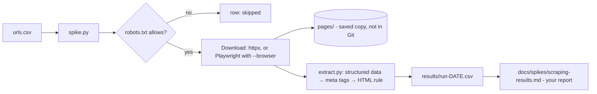

# Feature Plan: Milestone 1, Scraping Spike

*Status: approved on 2026-10-31. Planning only: no code has been written yet.*
*Parent plan: [docs/PROJECT_PLAN.md](../PROJECT_PLAN.md), milestone 1.*

Facts are labelled **Verified** (checked on 2026-10-31), **Estimate** or **Assumption**.

---

## 1. Feature summary and user story

A **throwaway experiment**: code written only to answer a question, not reused as-is in the real app. A small Python script tries to read title, price and currency from 2 real pages on each of 5 Romanian sites (emag.ro, altex.ro, olx.ro, storia.ro, imobiliare.ro), on 2 different days. Its findings decide which 2 sites the MVP will support.

> *As the developer of Price Tracker, I want to find out which of my 5 sites a program can reliably read prices from, so that I choose the 2 MVP sites based on evidence, not guesses.*

## 2. Problem, intended outcome, and scope

- **Problem:** automatic tracking is the riskiest part of the project. Altex already timed out on a basic request. Building Django features around a site we can't read would waste weeks.
- **Outcome:**
  - a results report that gives each site a classification
  - 2 named MVP sites, with reasons
  - saved page copies for later tests

### In scope

- One small script that reads a list of 10 URLs (2 per site, chosen by the user), downloads each page, tries to extract **title, price and currency**, and records what happened.
- **Three extraction methods, tried in order.** The script records which one worked.
  1. **Structured data:** the hidden, machine-readable product block many sites embed. This is the most robust method.
  2. **Price meta tags:** small labels in the page header, such as `product:price:amount`.
  3. **Visible HTML:** a site-specific rule found by inspecting the page. This is the most fragile method.
- Round 2 with **Playwright** (a real, hidden browser), only for pages that failed round 1.
- Two runs on different days.
- Saved page copies in `spikes/scraping/pages/`, kept out of Git.
- A results report with a recommendation of the 2 MVP sites.

### Out of scope

- Django, a database, scheduling and currency conversion. Those are later milestones.
- Clean, reusable "adapter" code. That's built properly in Milestone 6.
- **Getting around protection:** no CAPTCHA solving, no proxy servers, no "stealth" tricks. Requests look like an ordinary browser visit and nothing more. **If a site blocks us, that block is the result.**

## 3. Requirements and acceptance criteria

### Functional requirements

| # | Requirement |
|---|---|
| FR1 | URLs are listed in a simple input file, each with its site name |
| FR2 | Before fetching, the script checks the site's `robots.txt` using Python's built-in reader, and skips pages that are disallowed |
| FR3 | The script waits about 20 seconds before giving up on a page, and pauses about 5 seconds between requests |
| FR4 | For each page it records: response code, whether it looks blocked (e.g. code 403/429, a CAPTCHA page, or an empty page), title, price, currency, the method that worked, and notes |
| FR5 | Prices are converted from the Romanian format into numbers, e.g. `2.499,99 lei` → 2499.99 RON, and `€ 85.000` → 85000 EUR |
| FR6 | Results are saved to a results file for each run |
| FR7 | A Playwright round re-tries only the failed pages and records results the same way |
| FR8 | The user compares each extracted price with what their own browser shows, and marks it correct or wrong |

### Non-functional requirements

- **Polite:** at most about 25 requests per run in total, from a single computer, with nothing running in parallel.
- **Simple:** short, heavily commented code a beginner can read and understand.
- **Runs locally:** Windows and Python 3.14.
- **Private:** saved pages never reach Git.

### Edge cases

- **Listing removed:** the page returns a 404 "not found" code, redirects to search results, or says "anunț inactiv".
- **No number to read:** the price says "preț la cerere" (price on request) or "negociabil".
- **Two prices on the page:** a discounted price next to the original. We take the **current selling price**.
- **Out of stock:** a price may still show. We record both the price and the out-of-stock state.
- **Cookie consent popups:** these may hide content from Playwright.
- **Timeouts and redirects:** Altex has already timed out once.
- **Romanian characters:** letters like ă, ș, ț must survive without being garbled.

### Validation

- A price must parse into a positive number.
- The currency must come out as RON or EUR ("lei" or "RON" means RON; "€" or "EUR" means EUR). Anything else is recorded as "unclear".

### How each site gets classified

| Result | Meaning |
|---|---|
| **Works** | The simple method is correct on 2 of 2 pages, on both days |
| **Works with Playwright** | Only the browser method succeeds reliably |
| **Blocked** | Refused, a CAPTCHA, or timeouts, even with Playwright |
| **Unclear** | Inconsistent, or the price can't be parsed reliably |

**Rule for choosing the 2 MVP sites:**

- Pick the best-scoring **shop** (eMAG or Altex) and the best-scoring **property site** (OLX, Storia or imobiliare.ro).
- If two sites tie, prefer "Works" over "Works with Playwright", then structured data over visible HTML.

### Acceptance criteria

1. **Given** the 10 URLs, **when** I run the script, **then** every URL gets a recorded result. Nothing crashes, even if a site times out.
2. **Given** a page with a visible price, **when** the extraction succeeds, **then** the recorded price and currency match what my browser shows.
3. **Given** a page that failed with the simple method, **when** I run round 2, **then** it gets a Playwright result.
4. **Given** both runs are done, **when** I open the report, **then** each site has a classification with evidence, and **2 MVP sites are named** with reasons.
5. **Given** the spike is finished, **when** I run `git status`, **then** no saved page copies show up as files to commit.

## 4. Current architecture and relevant existing code

**Verified** on 2026-10-31:

- The repository contains only `README.md` and `docs/PROJECT_PLAN.md`, plus `.claude/`. There's no application code, no `.gitignore`, and no dependency file.
- So there is **no existing code to reuse or break**. The spike is completely separate from the future Django app.

Earlier checks the same day (basic request plus the first lines of `robots.txt`):

- eMAG, OLX, Storia and imobiliare.ro answered normally.
- None of the `robots.txt` lines read block ordinary product or listing pages.
- Altex timed out with no response.

## 5. Proposed technical solution and rationale

**In plain English:**

1. You list your URLs in a spreadsheet-like file, `urls.csv`.
2. The script goes through them one by one. For each page it:
   - checks `robots.txt`
   - waits a few seconds, to be polite
   - downloads the page and saves a copy
   - tries the 3 extraction methods in order
   - writes one row of results
3. Afterwards you compare each extracted price with your browser.
4. Pages that failed are run again with `--browser`, which uses Playwright instead of a plain download.

**Why this fits this project:**

- It uses exactly the tools the approved project plan picked.
- The **extraction logic sits in its own file** (`extract.py`). That's the same idea as the planned adapters, so you practise the pattern before Milestone 6.
- **Prices are compared with your browser by hand.** We're not building automated checking for code that will be thrown away.

## 6. Technologies and dependencies

**Verified on PyPI (2026-10-31):**

| Library | Latest version | Python support | Role |
|---|---|---|---|
| httpx | 0.28.1 | requires ≥3.8 | Downloads pages (round 1) |
| beautifulsoup4 | 4.15.0 | requires ≥3.7 | Searches the HTML |
| playwright | 1.64.1 | officially lists 3.14 | Hidden-browser download (round 2) |

**Assumption:** httpx and BeautifulSoup don't explicitly *list* 3.14 support. They're pure Python, so they very likely work, and task 2 confirms it.

**From Python's standard library**, so nothing extra to install:

- `urllib.robotparser` checks `robots.txt`
- `csv` and `json` read and write files
- `decimal` holds exact prices
- `unittest` runs the tests

**Isolation:** the spike gets **its own virtual environment** in `spikes/scraping/.venv`. That's a private folder for its packages, so Playwright's large browser files never mix with the future Django app. Deleting the folder removes everything.

**New dependencies needing approval:** none beyond the approved project plan. Playwright is installed only in task 8, and only if some pages fail round 1.

## 7. Files and components likely to change

All of these are new, except the one small edit to the project plan.

| Path | Purpose | In Git? |
|---|---|---|
| `.gitignore` (repo root) | Ignores `spikes/scraping/pages/`, `.venv/` and `__pycache__/` | Yes |
| `spikes/scraping/README.md` | "Throwaway" notice and how to run it | Yes |
| `spikes/scraping/requirements.txt` | Exact library versions | Yes |
| `spikes/scraping/urls.csv` | site, URL, the price your browser shows | Yes |
| `spikes/scraping/extract.py` | The 3 extraction methods + the Romanian price parser | Yes |
| `spikes/scraping/test_extract.py` | Automated tests for the price parser | Yes |
| `spikes/scraping/spike.py` | Main script (`--browser` switches to Playwright) | Yes |
| `spikes/scraping/results/run-YYYY-MM-DD[-browser].csv` | Results for each run (titles and prices only) | Yes |
| `spikes/scraping/pages/` | Saved page copies (may contain sellers' names or phone numbers) | **No** |
| `docs/spikes/scraping-results.md` | Final report | Yes |
| `docs/PROJECT_PLAN.md` | **Small edit:** fill in open question #1 with the chosen sites | Yes |

## 8. Ordered implementation tasks

| # | Task | Depends on | Purpose | Done when |
|---|---|---|---|---|
| 1 | Create the folder, `.gitignore` and README | – | Protect privacy from the very first file | A test file in `pages/` doesn't show up in `git status` |
| 2 | Create the virtual environment, install httpx + BeautifulSoup, write `requirements.txt` | 1 | Isolated, repeatable setup | `import httpx, bs4` works on Python 3.14 |
| 3 | Fill in `urls.csv` with the 10 URLs and the price your browser shows today | 1 | Real test data | 10 rows, 2 per site |
| 4 | Price parser + its tests | 2 | The trickiest small piece, tested first | All parser tests pass |
| 5 | Polite download: robots check, timeout, pause, save the page, detect blocking | 2, 3 | Basic, safe fetching | Every URL gets a status; no crash when a page times out |
| 6 | Extraction: structured data → meta tags, recording which method worked | 4, 5 | Try the robust methods first | Results CSV filled in for each page |
| 7 | **Run 1** (day 1); compare with your browser; add an HTML rule only for pages where methods 1–2 failed but the page did load | 6 | First evidence | Each row marked correct, wrong or failed |
| 8 | Install Playwright + its browser; `--browser` round for the failed pages | 7 | Find out whether "failed" means hard or impossible | Every failed page has a browser result |
| 9 | **Run 2** on a different day (both methods as needed) | 7, 8 | Check stability | Second results file exists |
| 10 | Write the report, classify the sites, choose 2; skim each site's terms of use and note them; update open question #1 in the project plan | 9 | The decision this milestone exists for | Report and plan updated |

**Rollback:** everything is isolated and new. To undo, delete `spikes/scraping/` (including `.venv`) and the `.gitignore` lines. Nothing else in the project is touched, except the one-line edit to the project plan in task 10.

**Effort (Estimate):** about 6–12 hours of work, spread over at least 2 days because of the second run. It depends a lot on how cooperative the sites are.

## 9. Testing and verification strategy

**Automated tests** (`unittest`), for the price parser:

| Input | Expected result |
|---|---|
| `2.499,99 lei` | 2499.99 RON |
| `85.000 €` | 85000 EUR |
| `1 250 RON` | 1250 RON |
| `€ 450 / lună` | 450 EUR |
| `Preț la cerere` | no price |
| `0 lei` | rejected |
| `abc` | rejected |

**Manual checks:**

- Each extracted price is compared with your browser.
- `git status` is checked to confirm no saved pages show up.

**How each acceptance criterion is verified:**

| Criterion | How we check it |
|---|---|
| 1. Every URL gets a result | Count the rows in the results CSV |
| 2. Price matches the browser | Compare against your browser price (the "correct?" column) |
| 3. Failed pages get a browser result | Compare the browser-round CSV with the failed rows |
| 4. Report names 2 sites | Read `docs/spikes/scraping-results.md` |
| 5. No saved pages in Git | Run `git status` |

## 10. Security, privacy, and other risks

| Risk | Mitigation |
|---|---|
| A site temporarily blocks your home internet connection | Very low volume (≤25 requests per run) and pauses; stop at the first sign of blocking |
| Terms of use forbid automated access | Skim and note them in task 10; it matters for the site choice, especially before going public |
| Personal data in saved pages | Kept out of Git from task 1; delete after Milestone 6 if not needed |
| A listing disappears between runs | 2 URLs per property site; record it as "removed" (also useful evidence) |
| Playwright download is large or fails on Windows | Only needed in task 8; if it fails, those sites are classified "Blocked/Unclear" |
| Results differ between the two days | That's exactly what run 2 is for; classify such a site as "Unclear" |

## 11. Assumptions, dependencies, and open questions

- **Verified:** the repository state; library versions and Python support (PyPI); Python 3.14.0 installed.
- **Assumption:** httpx and BeautifulSoup work on Python 3.14 (very likely; confirmed in task 2).
- **Assumption:** the OLX URLs will be property or rental listings.
- **Dependency:** the user's 10 URLs (2 per site), and two different days to run the spike.
- **Open questions:** none blocking, apart from the URLs.

## 12. Decisions requiring the user's approval

| Decision | Status |
|---|---|
| Architectural gate | Not triggered: an isolated folder using already-approved tools |
| Pages to test: user picks 2 real pages per site | Approved |
| Spike lives in `spikes/scraping/`, committed for reference | Approved |
| Playwright round for pages that fail round 1 | Approved |
| "Works" = correct on 2 pages, on 2 different days | Approved |
| Saved page copies kept locally, out of Git | Approved |
| New root `.gitignore` | Approved (2026-10-31) |
| Small edit to `docs/PROJECT_PLAN.md` in task 10 | Approved (2026-10-31) |

## 13. What success looks like

Two dated results files and a short report, which say for example: "eMAG works via structured data on both days; Storia works via structured data; Altex is blocked even with Playwright". The report names your 2 MVP sites with reasons, and saved page copies sit safely outside Git, ready for Milestone 6 tests.
