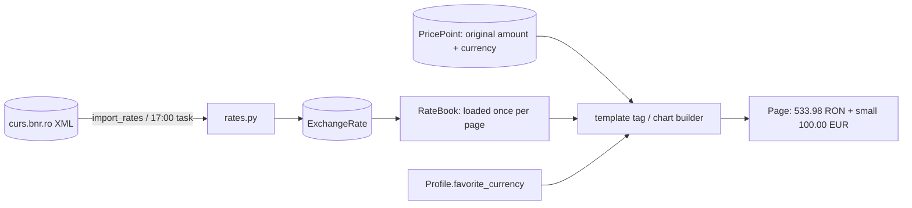

# Feature Plan: Milestone 4, Currencies

*Status: approved on 2026-11-06. Planning only: no code has been written yet.*
*Parent plan: [docs/PROJECT_PLAN.md](../PROJECT_PLAN.md), milestone 4. Builds on the daily task from [milestone 7](milestone-7-daily-checks.md).*

Facts are labelled **Verified** (checked on 2026-11-06), **Estimate** or **Assumption**.

---

## 1. Feature summary and user story

Every price is shown in the viewer's favourite currency (RON or EUR), converted at the official **BNR (National Bank of Romania) rate for the day the price was recorded**, with the original amount underneath.

- **Rate history** is loaded once.
- **New rates** come with the 17:00 daily task.
- **Charts, lists, comparisons and messages** all use the viewer's currency.

> *As a household member, I want every price shown in my favourite currency at that day's official rate, so that I can compare RON and EUR prices honestly over time.*

## 2. Problem, intended outcome, and scope

- **Problem:** prices are shown only in their original currency. A 400 EUR rent and a 1,971 RON bill can't be compared, and an item's chart mixes RON and EUR points on one line.
- **Outcome:** one currency per viewer, everywhere, at historically accurate rates.

### In scope

- **A rates module** that reads BNR's daily and yearly XML files and saves EUR rates.
- **An `import_rates` command** for the one-time history load.
- **The rate fetch added to the 17:00 daily task.**
- **A conversion function**, plus a display helper used by the 5 price places and the chart.
- **Converted amounts in the "Check now" and "Add by link" success messages.**
- **Updated notes** on the settings and comparison-form pages.
- Tests and a README section.

### Out of scope

- Currencies other than RON and EUR.
- The "↓8% / lowest ever" indicators (M5).
- The comparison **chart** (M8). The comparison **table** does show converted prices.
- Changing what is stored: prices always stay saved in their original currency.

## 3. Requirements and acceptance criteria

### Functional requirements

| # | Requirement |
|---|---|
| FR1 | `import_rates` loads EUR rates from BNR's yearly files, from the **year before** the earliest of (oldest price date, 1 Jan 2025) up to the current year, plus the daily file |
| FR2 | Re-running it is safe: existing days are skipped or updated, never duplicated (the existing unique rule on date + currency guarantees this) |
| FR3 | The reader **ignores the XML namespace** (2025 files use `http://www.bnr.ro/xsd`, 2026 files `https://www.bnr.ro/xsd`) and applies `multiplier` when present |
| FR4 | **The daily task imports the latest rates first.** If BNR is unreachable, it logs a warning and **still checks prices** |
| FR5 | **Conversion:** amount × (RON per unit of the original currency) ÷ (RON per unit of the target), with RON = 1, using the **latest rate on or before** the price's local date |
| FR6 | **Display:** if the viewer's currency differs from the original and a rate exists, show the converted amount **large** and the original **small** underneath; if they're the same, just the amount; if there's no rate, the original plus a small "no rate" note |
| FR7 | **Chart:** every point is drawn in the viewer's currency; the tooltip also shows the original, e.g. "1,971.30 RON (400.00 EUR)"; points with no rate are left out of the line, with a note under the chart |
| FR8 | **Messages:** "Check now" and "Add by link" success messages add "(≈ X EUR)" when the viewer's currency differs. The stored check history (`CheckAttempt` messages, daily log) stays in the original currency. |
| FR9 | The settings and comparison-form notes no longer say conversion "isn't enabled" |
| FR10 | Converted amounts are rounded to 2 decimals for display only; stored prices never change |

### Non-functional requirements

These are qualities rather than features.

- **Fast:** each page loads the rates it needs **once** instead of once per price, since a chart can have hundreds of points.
- **Polite:** the history load is about 4 file downloads (3 yearly + daily), and the daily fetch is 1.
- **Tested offline:** tests use small copies of BNR files, never the internet.

### Edge cases

- **Price on a weekend or holiday:** uses the previous banking day's rate.
- **Price recorded today before BNR publishes** (around 13:00): uses the previous banking day's rate until today's arrives. Prices are converted when shown, so they correct themselves after the import.
- **A 1 January price:** BNR's first rate of a year is around 3 January, so the previous year's last rate is used. This is why the history load fetches one extra year.
- **Price older than the loaded history:** original plus "no rate".
- **The empty rates table before the first import:** everything shows as today, plus "no rate" notes. Nothing breaks.
- **The viewer switches favourite currency:** every page changes instantly, because nothing stored changes.
- **Two users with different favourite currencies:** each sees their own.

### Acceptance criteria

1. **Given** a 100 EUR price recorded on 2026-11-05 and a BNR rate of 5.3398 that day, **when** a RON user views it, **then** they see **533.98 RON**, with "100.00 EUR" underneath.
2. **Given** a price on Saturday 2026-11-07, **when** viewed, **then** Friday's rate is used.
3. **Given** a 1 January price, **when** viewed after the history load, **then** the previous year's last rate (31 December) is used.
4. **Given** an EUR user and a RON price, **when** viewed, **then** it's converted to EUR, and the chart line is entirely in EUR.
5. **Given** no rate at all for a price's date, **when** viewed, **then** the original amount and a "no rate" note are shown, and the page doesn't break.
6. **Given** BNR is down during the 17:00 run, **when** the task runs, **then** a warning is logged and prices are still checked.
7. **Given** `import_rates` runs twice, **when** finished, **then** no rate appears twice.
8. **Given** "Check now" finds a new RON price and my currency is EUR, **when** the message appears, **then** it includes "(≈ … EUR)".
9. **Given** the test suite, **when** run, **then** everything passes offline.

## 4. Current architecture and relevant existing code (Verified 2026-11-06)

| What | Where | Relevance |
|---|---|---|
| `ExchangeRate` (date, currency, `ron_per_unit` with 6 decimals, unique per date + currency) | `ui/tracker/models.py` | Used as-is: **no migration**. Currently empty. |
| `Profile.favorite_currency` (RON / EUR) | `ui/tracker/models.py`, `templates/tracker/settings.html` | Becomes the display currency; saved today but unused |
| Prices printed raw (`amount` + `currency`) | `dashboard.html` (recent items, price activity), `item_list.html`, `item_detail.html`, `comparison_detail.html` | Switch to converted display |
| Chart data built from `point.amount` | `item_detail()` in `ui/tracker/views.py`; tooltip in `ui/tracker/static/tracker/js/price-history.js` | Values converted; tooltip shows the original |
| Daily loop | `run_daily_checks()` in `ui/tracker/daily.py` | Imports the latest rates before checking prices |
| Success messages | `item_check()`, `item_add_link()` in `ui/tracker/views.py` | Get "(≈ X EUR)" |
| "Not enabled yet" notes | `settings.html`, `comparison_form.html` | Updated |
| No `templatetags/` folder; only Django's built-in context processors | `ui/tracker/`, `ui/app/settings.py` | Both are new (see section 5) |
| BNR yearly files: `https://curs.bnr.ro/files/xml/years/nbrfxrates2025.xml` (248 days, EUR 4.9749 on 3 Jan → 5.0985 on 31 Dec) and `…2026.xml` (213 days, up to 5 Nov 2026, EUR 5.3398); daily `https://curs.bnr.ro/nbrfxrates.xml` | Downloaded and parsed on 2026-11-06 | Namespace differs between files; `multiplier="100"` is used for some currencies (not EUR) |

## 5. Proposed technical solution and rationale

**In plain English:**

1. **Rates in:** a small module downloads BNR's XML files, picks out the EUR rate for each day, and saves it in `ExchangeRate`.
2. **Rates out:** for each page, a **rate book** loads all saved EUR rates into memory once. It can then answer *"what was the rate on or before 7 November?"* instantly, so even a chart with hundreds of points needs only one database query.
3. **Display:** a small **template tag** (a reusable helper called from inside an HTML template) works out the display price for each point: converted amount + currency, the original amount, and a "no rate" flag. A tiny shared snippet, `_price.html`, renders it the same way everywhere.
4. **Who gets which currency:** a **context processor** (a function Django runs for every page) puts the viewer's favourite currency and a rate book into every template. This adds **one line to `ui/app/settings.py`**. The rate book is only loaded from the database when a page actually shows a price.

**Example, for a RON user:** a 100 EUR point recorded on Thursday 2026-11-05 → the rate book returns 5.3398 for that day → it shows **533.98 RON**, with "100.00 EUR" underneath. The same point viewed on the weekend still uses Thursday's rate, because the rate is chosen by the price's date, not today's.

**Why this fits the app:**

- Nothing stored changes, so it's completely reversible.
- Switching currency works instantly.
- It follows Django's standard patterns (template tags and context processors).
- It reuses httpx, which is already installed.

**Alternatives considered:**

| Option | Why not |
|---|---|
| Store converted amounts in the database | Breaks when the viewer switches currency, and needs a migration |
| Convert in each view by hand | The same code repeated in 5 places, so it's easy to miss one |
| ECB rates instead of BNR | Also verified working, but the project plan chose BNR as the official RON source |

## 6. Technologies and dependencies

- **No new packages:** it uses `httpx` (installed), Python's built-in XML reader `xml.etree.ElementTree`, `bisect` for date lookups, and Django template tags and context processors.
- **No database change:** `ExchangeRate` already exists.
- **One settings line:** register `tracker.context_processors.currency` in `TEMPLATES` in `ui/app/settings.py`.

## 7. Files and components likely to change

| File | Change |
|---|---|
| `ui/tracker/rates.py` | **New:** download and parse BNR files (namespace-agnostic, `multiplier`), `import_rates(since)`, `import_latest_rates()` |
| `ui/tracker/money.py` | **New:** `RateBook` (rate on or before a date) and `display_price(point, currency, book)` |
| `ui/tracker/context_processors.py` | **New:** the viewer's currency plus a rate book that's only loaded when needed |
| `ui/tracker/templatetags/__init__.py`, `ui/tracker/templatetags/prices.py` | **New:** `` |
| `ui/tracker/templates/tracker/_price.html` | **New:** shared price snippet |
| `ui/tracker/management/commands/import_rates.py` | **New:** `import_rates [--since YYYY-MM-DD]` |
| `ui/app/settings.py` | Add the context processor (1 line) |
| `ui/tracker/daily.py` | Import the latest rates before checking prices; a warning if BNR fails |
| `ui/tracker/views.py` | Converted chart data in `item_detail()`; "(≈ X)" in `item_check()` and `item_add_link()` messages |
| `dashboard.html`, `item_list.html`, `item_detail.html`, `comparison_detail.html` | Use the price snippet |
| `settings.html`, `comparison_form.html` | Remove the "not enabled yet" notes |
| `ui/tracker/static/tracker/js/price-history.js` | Tooltip shows the original too; a gap note for points without a rate |
| `ui/tracker/tests/test_rates.py`, `ui/tracker/tests/test_money.py`, `ui/tracker/tests/fixtures/bnr_*.xml` | **New** tests, with small BNR samples (both namespaces, plus a multiplier) |
| `ui/tracker/tests/test_daily.py`, `ui/tracker/tests/test_views.py` | Fake BNR in daily tests; display and message tests |
| `README.md` | "Exchange rates" section |

## 8. Ordered implementation tasks

| # | Task | Depends on | Purpose / rollback |
|---|---|---|---|
| 1 | `rates.py` + tests (parse both namespaces, multiplier, re-import safe) | – | Rates in; tested offline |
| 2 | `import_rates` command + **one real history load** into the real database (about 4 downloads: 2024, 2025 and 2026 yearly files + daily) | 1 | Real data. Rollback: delete the `ExchangeRate` rows, which are just a copy of public BNR data. |
| 3 | `money.py` (`RateBook`, conversion, display price) + tests (weekend, 1 January, no rate, same currency) | 1 | The conversion core |
| 4 | Context processor + settings line + template tag + `_price.html` | 3 | Shared plumbing. Rollback: remove the line from `settings.py`. |
| 5 | The 5 price places in templates | 4 | Converted lists, tables and dashboard |
| 6 | Chart data + tooltip | 3 | Charts in one currency |
| 7 | Messages "(≈ X)" + updated notes | 3 | FR8, FR9 |
| 8 | Daily task: import the latest rates first, a warning on failure; fake BNR in daily tests | 1 | FR4 |
| 9 | README, full test run, manual check in the browser | 1–8 | Done-check |

**Effort (Estimate):** about 4–6 hours.

## 9. Testing and verification strategy

- **`test_rates.py`:**
  - parses both the `http://` and `https://` BNR files
  - applies `multiplier`
  - skips non-EUR currencies
  - a second import doesn't duplicate
  - a download failure raises a clear error
- **`test_money.py`:**
  - exact acceptance example: 100 EUR on 2026-11-05 at 5.3398 → 533.98 RON
  - EUR ← RON
  - Saturday → Friday's rate
  - 1 January → 31 December
  - no rate → `None` and the "no rate" flag
  - same currency → no conversion
- **View tests:**
  - a RON user and an EUR user see different amounts for the same item
  - the original appears underneath
  - the chart data is all in one currency
  - the "no rate" note appears
  - messages include "(≈ … EUR)"
- **Daily tests:** BNR down → warning logged, prices still checked; the existing daily tests get a fake BNR so they stay offline.
- **Manual:** after the real history load, open an EUR item while set to RON and compare one amount with BNR's published rate for that day.

| Acceptance criterion | How it's verified |
|---|---|
| 1–5 | `test_money.py` + view tests |
| 6 | Daily tests |
| 7 | `test_rates.py` |
| 8 | View tests |
| 9 | Full suite (`python manage.py test tracker`) |

## 10. Security, privacy, and other relevant risks

| Risk | Mitigation |
|---|---|
| BNR changes its file format or address | The parser is tolerant (it already handles both namespaces); a failure only logs a warning and prices still show, just unconverted |
| Wrong conversion direction (dividing instead of multiplying) | The exact acceptance example in tests, plus a manual check against BNR's published number |
| Slow pages from many rate lookups | The rate book loads rates once per page and looks them up in memory |
| Rounding confusion | Stored values are never rounded; display uses 2 decimals; the original is always visible |
| A missing profile for an old account | The context processor uses `get_or_create`, matching `settings_view` |
| Privacy | Exchange rates are public data; no personal data is added or shared |

## 11. Assumptions, dependencies, and open questions

- **Verified:** the BNR yearly 2025/2026 and daily files, their namespaces and multipliers; all the code locations in section 4.
- **Assumption:** only EUR rows are stored, since RON is BNR's base currency.
- **Dependency:** the M7 daily task (built; it must be registered with `scripts\register_daily_check.ps1` for daily rate updates to happen).
- **Open questions:** none.

## 12. Decisions requiring the user's approval

| Decision | Status |
|---|---|
| Show converted prices everywhere, original underneath | Approved (2026-11-06) |
| History from the oldest price or 1 Jan 2025, **plus the year before** | Approved |
| Rates via the 17:00 task + an `import_rates` command | Approved |
| Earlier-rate fallback; "no rate" note otherwise | Approved |
| Messages show the converted amount | Approved |
| No migration; a context processor (+1 line in `settings.py`) and a template tag | Approved |
| One real history load into the real database during implementation | Approved |
| Architecture gate | Not triggered: no new table, package or service |

## 13. What success looks like

You open the Militari studio while your currency is RON and see **2,509.71 RON** (Estimate: 470 × 5.3398), with "470.00 EUR" underneath. Hovering over a chart point shows both. You switch to EUR in Preferences and every page instantly shows euros, with RON prices converted at each day's BNR rate. The 17:00 task keeps the rates up to date without you doing anything.
