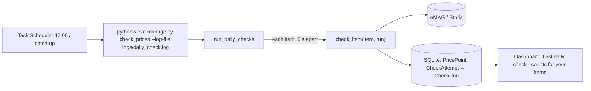

# Feature Plan: Milestone 7, Daily Scheduled Price Checks

*Status: approved on 2026-11-06. Planning only: no code has been written yet.*
*Parent plan: [docs/PROJECT_PLAN.md](../PROJECT_PLAN.md), milestone 7. Builds on automatic tracking (M6, commit `a6d08e2`).*

Facts are labelled **Verified** (checked on 2026-11-06), **Estimate** or **Assumption**.

---

## 1. Feature summary and user story

Every day at **17:00**, or as soon as the PC is on if 17:00 was missed, Windows Task Scheduler runs `python manage.py check_prices`. The command checks every household member's active automatic items (eMAG, Storia), logs the results, and records a summary that each person sees on their dashboard.

> *As a household member, I want my tracked prices to be checked automatically every day, so that the price history keeps growing even when nobody opens the app.*

## 2. Problem, intended outcome, and scope

- **Problem:** today, prices are only re-checked when someone presses "Check now". Every unchecked day is a missing point in the history that can't be recovered.
- **Outcome:** one automatic check per item per day, unattended, with a visible summary.

### In scope

- **The `check_prices` management command** (a script that runs inside the Django app):
  - checks every household member's checkable items
  - `--force` ignores the 20-hour skip, for testing
  - `--log-file` writes a log file
- **A `CheckRun` table** recording each daily run, plus an optional link from each `CheckAttempt` to its run.
- **A dashboard line:** "Last daily check: *[time]* · X OK · Y new prices · Z need attention", for the viewer's own items.
- **`scripts/register_daily_check.ps1`:** registers the Task Scheduler task. **The user runs it themselves.**
- **README:** a "Daily checks" section, plus an update to the outdated "Current scope" paragraph.

### Out of scope

- Exchange-rate import (M4 will add it to the same daily task later).
- Email or phone notifications.
- New sites.
- Running while the user is logged out of Windows, because that would mean storing their Windows password in Task Scheduler.

## 3. Requirements and acceptance criteria

### Functional requirements

| # | Requirement |
|---|---|
| FR1 | `check_prices` checks every item where `can_be_checked()` is true (automatic, has a URL, not paused or removed), for **all users** |
| FR2 | Items checked in the last **20 hours** are skipped, whether manually or by an earlier run, so catch-up plus regular runs never double-check. `--force` ignores this. |
| FR3 | About a **5-second pause** between items; one item at a time, never in parallel |
| FR4 | **One failing item never stops the run.** An unexpected crash on one item is recorded as an *error* `CheckAttempt` for that item, and the run continues. |
| FR5 | Each run saves a `CheckRun` (start, end, checked / OK / need attention / removed / skipped); each of its `CheckAttempt`s links to it |
| FR6 | **No overlapping runs:** if a run started under an hour ago and hasn't finished, a second one exits with "already running" and checks nothing |
| FR7 | Writes a readable summary, one line per item plus totals, to the console or the `--log-file`, with the date and time |
| FR8 | The registration script creates the task **"Price Tracker daily check"**: daily at **17:00**, *run as soon as possible after a missed start* switched on, only while the user is logged on. The README explains how to remove it. |
| FR9 | **Dashboard:** "Last daily check: *[time]* · X OK · Y new prices · Z need attention", counting **only the viewer's own items**; "No daily check has run yet" when there is none; "did not finish" for an interrupted run |

"New prices" counts the viewer's automatic price points created between the run's start and end. "OK / need attention" come from the viewer's `CheckAttempt`s linked to that run.

### Non-functional requirements

These are qualities rather than features.

- **Polite:** the same timeouts and `robots.txt` rules as "Check now", one request at a time.
- **Safe:** no passwords stored, and the task runs as the logged-in user.
- **Private:** each person's dashboard summary only counts their own items.
- **Tested offline:** automated tests never touch the internet.

### Edge cases

- **No automatic items:** the run finishes and reports "0 checked".
- **PC off at 17:00:** it runs once at the next start-up, and the 17:00 run that day is skipped by the 20-hour rule if it comes too soon.
- **A site is down for the whole run** (e.g. eMAG's 503 Black Friday page): those items get *Needs attention*, the others carry on, and the next day can recover.
- **Run interrupted** (PC shut down halfway): the `CheckRun` is left unfinished; the next run ignores it once it's over an hour old, and the dashboard says "did not finish".
- **"Check now" pressed during a run:** both work. SQLite briefly makes one wait, which is fine at household scale.

### Acceptance criteria

1. **Given** 3 automatic items (one checked 2 hours ago), **when** `check_prices` runs, **then** 2 are checked and 1 is skipped, and a `CheckRun` records it.
2. **Given** one item whose site is down, **when** the run happens, **then** that item is *Needs attention* and the other items are still updated.
3. **Given** a run in progress, **when** a second run starts, **then** it exits with "already running" and checks nothing.
4. **Given** `--force`, **when** run, **then** recently checked items are checked too.
5. **Given** my items were in last night's run, **when** I open the dashboard, **then** I see the time and counts for **my** items only; other users' results aren't counted.
6. **Given** no run yet, **when** I open the dashboard, **then** it says "No daily check has run yet."
7. **Given** I run `register_daily_check.ps1`, **when** I open Task Scheduler, **then** the task exists at 17:00 with catch-up on. *(Verified manually by the user.)*
8. **Given** the test suite, **when** I run `python manage.py test`, **then** everything passes offline.

## 4. Current architecture and relevant existing code (Verified 2026-11-06)

| What | Where | Relevance |
|---|---|---|
| `check_item(item, now=None)`, `can_be_checked(item)`, `_record(...)` | `ui/tracker/checks.py` | The engine. It adds a price point only when the price changed or it's a new day, updates the status and records a `CheckAttempt`. Only needs an optional `run` passed through. |
| `CHECK_COOLDOWN` (10 min) | `ui/tracker/checks.py` | For the "Check now" button only; the daily run uses its own 20-hour rule |
| `CheckAttempt` (item, attempted_at, outcome, message) | `ui/tracker/models.py` | Gets an optional `run` link |
| `dashboard()` view and `dashboard.html` | `ui/tracker/views.py`, `ui/tracker/templates/tracker/` | Get the summary line; the view already filters everything by `owner=request.user` |
| Fake-internet test helpers | `ui/tracker/tests/helpers.py` | Reused for offline tests |
| No `ui/tracker/management/`, `scripts/` or `logs/` folders | – | All new |
| README "Current scope" says scheduled checks and adapters are "future work" | `README.md` | Outdated, so it gets updated |
| `Register-ScheduledTask` and `New-ScheduledTaskSettingsSet -StartWhenAvailable` | Windows (checked on this PC) | Available; no task named "Price Tracker daily check" exists yet |
| PowerShell execution policy: all scopes *Undefined*, so effectively **Restricted** for normal sessions | `Get-ExecutionPolicy -List` | Windows won't run `.ps1` files by default, so the scheduled task must not depend on a script |

## 5. Proposed technical solution and rationale

**In plain English:** a small Django command loops over all checkable items. For each one it skips it if it was checked in the last 20 hours, otherwise calls `check_item()`, then waits 5 seconds. It stores the totals in a `CheckRun` row. Windows Task Scheduler starts that command at 17:00.



### Design decisions

- **The task runs Python directly, not a `.ps1` script.** This avoids the PC's restricted script policy.
  - It uses **`pythonw.exe`**, the windowless version of Python, so no console window pops up at 17:00.
  - `pythonw` has nowhere to print, so the command writes its own log with **`--log-file`**.
- **The run logic lives in `ui/tracker/daily.py`; the command is a thin wrapper.** Tests can call the logic directly and quickly, with the pause turned off.
- **Per-item safety net:** an unexpected exception while checking one item is recorded as an error for that item, and the loop continues.
- **No overlapping runs:** an unfinished `CheckRun` from the last hour means "already running". An older unfinished one counts as "did not finish".
- **The dashboard counts only the viewer's items:** their `CheckAttempt`s linked to the latest run, plus their automatic price points created during it.

### Registration

`scripts/register_daily_check.ps1` builds the task: a daily 17:00 trigger, *Start when available* on, run only while the user is logged on, action `.venv\Scripts\pythonw.exe manage.py check_prices --log-file ..\logs\daily_check.log`, working folder `ui\`. The user runs it **once**:

```powershell
powershell -ExecutionPolicy Bypass -File scripts\register_daily_check.ps1
```

`Bypass` applies only to that one command; the system setting stays unchanged. The README also gives the one-line command to remove the task (`Unregister-ScheduledTask`).

## 6. Technologies and dependencies

- **No new packages.** It uses Django management commands, Python's `logging` and Windows' built-in Task Scheduler.
- **New database table, `CheckRun`:**
  - fields: `started_at`, `finished_at` (empty while running), and the counts `checked`, `ok`, `attention`, `removed`, `skipped`
  - plus `CheckAttempt.run`: an optional link to a `CheckRun`, empty for manual checks
  - one additive migration (`0003`) that changes no existing data and can be reversed

## 7. Files and components likely to change

| File | Change |
|---|---|
| `ui/tracker/models.py` | Add `CheckRun`; add `CheckAttempt.run` |
| `ui/tracker/migrations/0003_….py` | **New**, generated by `makemigrations` |
| `ui/tracker/admin.py` | Register `CheckRun` |
| `ui/tracker/checks.py` | `check_item(item, now=None, run=None)`; `_record` stores `run` |
| `ui/tracker/daily.py` | **New:** `run_daily_checks(force=False, pause_seconds=5, ...)` |
| `ui/tracker/management/__init__.py`, `ui/tracker/management/commands/__init__.py`, `ui/tracker/management/commands/check_prices.py` | **New:** the command, with `--force` and `--log-file` |
| `ui/tracker/views.py`, `ui/tracker/templates/tracker/dashboard.html` | The "Last daily check" line |
| `ui/tracker/tests/test_daily.py` | **New** tests; plus dashboard tests in `test_views.py` |
| `scripts/register_daily_check.ps1` | **New**, run by the user |
| `.gitignore` | Add `logs/` |
| `README.md` | "Daily checks" section; update the "Current scope" paragraph |

## 8. Ordered implementation tasks

| # | Task | Depends on | Purpose / rollback |
|---|---|---|---|
| 1 | **Back up `ui/db.sqlite3`** (copy to `db.backup-<date>.sqlite3`), then add the model, migration and admin, and run `migrate` | – | **Database change.** Rollback: `python manage.py migrate tracker 0002` removes the table and link, or restore the backup copy. |
| 2 | Pass `run` through `check_item` and `_record` | 1 | Link attempts to runs; all existing tests must still pass |
| 3 | `daily.py`: loop, 20-hour skip, `--force`, pause, per-item safety net, "already running", totals | 2 | The core of the feature, tested first |
| 4 | `check_prices` command + `--log-file` | 3 | The entry point Task Scheduler calls |
| 5 | Dashboard line + view changes | 1 | What users see |
| 6 | Registration script, `.gitignore` (`logs/`), README | 4 | Setup and docs |
| 7 | **One real run** with `--force` on the real database, then **the user** registers the task and checks it in Task Scheduler | 1–6 | Real-world proof. The real run makes about 2 requests per automatic item. |

**Effort (Estimate):** about 3–5 hours, depending mostly on testing.

## 9. Testing and verification strategy

**Automated tests** (offline, using the fake internet from `tests/helpers.py`). `test_daily.py` covers:

- checking vs. skipping (20 hours)
- `--force`
- one failing site not stopping the others
- an unexpected exception being recorded and the run continuing
- "already running", and stale unfinished runs being ignored
- `CheckRun` totals
- a `call_command` test that writes the log file

The dashboard tests cover:

- counts for the viewer only (another user's items in the same run are ignored)
- the "No daily check has run yet" text
- the "did not finish" text

The whole suite (`python manage.py test tracker`) must pass.

**Manual checks:**

- Task 7's real run, and its log output.
- `Get-ScheduledTask -TaskName "Price Tracker daily check"` shows the 17:00 trigger and `StartWhenAvailable = True`.
- Next day: the log file has a new entry and the dashboard line is updated.

| Acceptance criterion | How it's verified |
|---|---|
| 1–4 | `test_daily.py` |
| 5–6 | Dashboard tests in `test_views.py` |
| 7 | The user's manual check in Task Scheduler |
| 8 | `python manage.py test tracker` |

## 10. Security, privacy, and other relevant risks

| Risk | Mitigation |
|---|---|
| The migration damages the database | Backup first; additive change only; reversible |
| The task silently doesn't run (wrong path, policy) | The task calls `pythonw.exe` with full paths, no script; task 7 verifies it; the log file and dashboard line show whether it ran |
| PC asleep or off at 17:00 | *Start when available* runs it afterwards; the 20-hour rule prevents doubles |
| A site blocks repeated daily visits | One visit per item per day, 5 seconds apart, `robots.txt` respected; failures show as *Needs attention* |
| `robots.txt` is fetched once per item | Fine at household scale; caching per run could be a later improvement |
| Another user's results shown on your dashboard | Dashboard queries filter by owner; covered by a test |
| Passwords stored for unattended runs | Avoided: the task only runs while the user is logged on |

## 11. Assumptions, dependencies, and open questions

- **Verified:** the code paths in section 4; `Register-ScheduledTask` and `StartWhenAvailable` available; execution policy effectively restricted; no existing task with this name.
- **Assumption:** `.venv\Scripts\pythonw.exe` exists, since it's standard in Python virtual environments. Confirm at implementation time.
- **Assumption:** the 20-hour skip and the 5-second pause between items.
- **Dependency:** M6's `check_item()` (done), and the `.venv` at the project root.
- **Open questions:** none blocking.

## 12. Decisions requiring the user's approval

| Decision | Status |
|---|---|
| 17:00 daily, with catch-up after a missed start | Approved (2026-11-06) |
| Checks all household members' items | Approved |
| Prices only; exchange rates come with M4 | Approved |
| The user registers the task with the provided script | Approved |
| Dashboard summary line | Approved |
| New `CheckRun` table + `CheckAttempt.run` link (migration 0003) | Approved |
| The task runs `pythonw.exe` directly (no `.ps1`), logging via `--log-file` | Approved |
| Back up `db.sqlite3` before migrating | Approved |
| Architecture gate | Not triggered: one additive table, no new services |

## 13. What success looks like

At 17:00 the PC quietly checks every tracked eMAG and Storia item and appends a dated summary to `logs/daily_check.log`. When a household member opens the app, their dashboard says *"Last daily check: today 17:00 · 3 OK · 1 new price · 0 need attention"*. Over a few weeks, the price charts fill in on their own.
